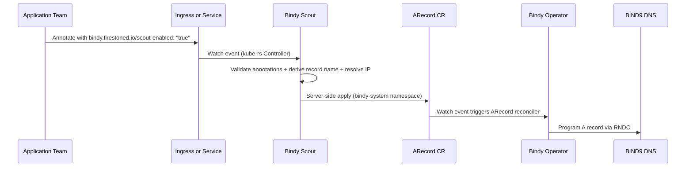
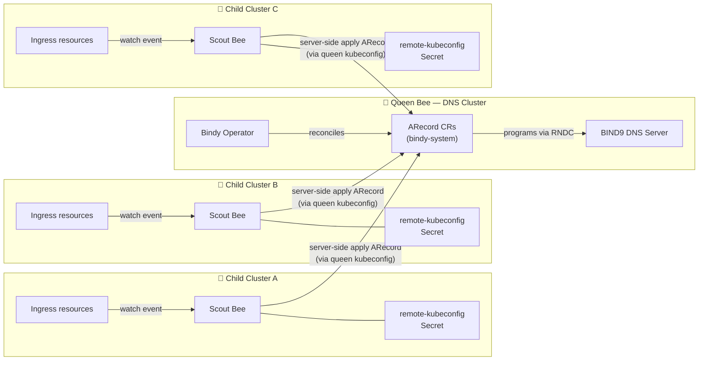
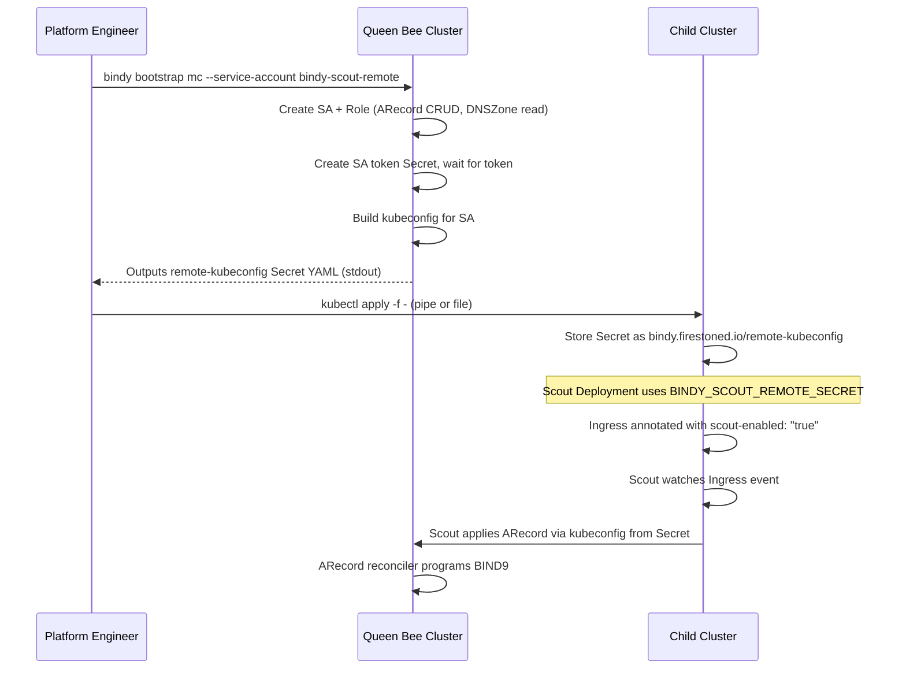

#  Bindy Scout

!!! info "Two Deployment Modes"
    **[Same-cluster mode](#quick-start)** (default): Scout and the Bindy operator run in the same cluster. No extra configuration needed.

    **[Remote cluster mode](#multi-cluster-mode)**: Scout runs on a workload cluster and writes to a dedicated Bindy cluster elsewhere. Set `BINDY_SCOUT_REMOTE_SECRET` to a Secret containing a kubeconfig for the Bindy cluster. Scout will create ARecords and validate zones there while watching local Ingresses and Services.

## The Scout Bee

In a honeybee colony, **scout bees** are the advance team. While the main workers tend the hive, a small number of scouts venture out into the surrounding terrain, find promising flower patches, return to the hive, and communicate their discoveries through the *waggle dance* — a precise, information-rich signal that tells their sisters exactly where the nectar is.

**Bindy Scout** plays the same role in your Kubernetes infrastructure.

The main `bindy run` process is the hive — it manages BIND9 DNS infrastructure and reconciles DNS zones and records from their canonical CRD definitions. But it doesn't know about every application that flies around your cluster. That's where Scout comes in.

Scout is a lightweight, event-driven controller that ventures into your workload namespaces, watches `Ingress` and `LoadBalancer Service` resources, and — when it finds one annotated with the right signal — carries that DNS information back to the bindy cluster and registers an `ARecord` on the application's behalf.

The application team annotates their Ingress or Service. Scout finds it, validates it, derives the correct record name from the DNS zone, and server-side applies the `ARecord` CR in the bindy namespace. From there, the normal `ARecord` reconciler picks it up and programs BIND9. The application never needs to know how DNS works — it just raises a flag and Scout handles the rest.

---

## What Scout Solves

In a multi-team platform, the DNS operator and the application teams live in different worlds:

- The **platform team** owns the `bindy-system` namespace, the `DNSZone` CRs, and the BIND9 instances.
- **Application teams** own their own namespaces, `Deployment` objects, and `Ingress` resources.

Bridging this gap traditionally requires either:

- Manual DNS record management (error-prone, doesn't scale), or
- Granting application teams write access to the `bindy-system` namespace (violates least-privilege).

Scout eliminates both compromises. Application teams annotate their own Ingresses — resources they already own — and Scout does the translation work. No cross-namespace write access required on the application side.

---

## How It Works



1. Scout watches **all `Ingress` and `LoadBalancer Service` resources** cluster-wide (excluding its own namespace and any configured exclusions).
2. When a watch event fires, Scout checks for the `bindy.firestoned.io/scout-enabled: "true"` annotation.
3. If enabled, Scout reads the zone annotation, derives the DNS record name, and resolves the IP — from the LoadBalancer status or an explicit annotation override.
   - **Ingress**: record name derived by stripping the zone suffix from each rule host (e.g. `app.example.com` in zone `example.com` → `app`). One `ARecord` per rule host.
   - **Service**: record name is the Service name. Exactly one `ARecord` per Service.
4. Scout **server-side applies** an `ARecord` CR in the configured target namespace (default: `bindy-system`), stamped with labels identifying the source cluster, namespace, and resource.
5. The main bindy operator's `ARecord` reconciler picks up the new CR and programs BIND9.

---

## Quick Start

### 1. Annotate your Ingress or Service

**Minimal** — when Scout is configured with `--default-zone` and `--default-ips`:

```yaml
apiVersion: networking.k8s.io/v1
kind: Ingress
metadata:
  name: my-app
  namespace: my-app-ns
  annotations:
    bindy.firestoned.io/scout-enabled: "true"
spec:
  rules:
    - host: my-app.example.com
      ...
```

**With overrides** — per-Ingress zone and IP take precedence over Scout defaults:

```yaml
apiVersion: networking.k8s.io/v1
kind: Ingress
metadata:
  name: my-app
  namespace: my-app-ns
  annotations:
    bindy.firestoned.io/scout-enabled: "true"
    # Override the default zone for this Ingress (optional when --default-zone is set)
    bindy.firestoned.io/zone: "example.com"
    # Optional: explicit IP override (overrides --default-ips and LB status)
    # bindy.firestoned.io/ip: "10.0.1.42"
    # Optional: TTL override in seconds (defaults to zone TTL)
    # bindy.firestoned.io/ttl: "300"
spec:
  rules:
    - host: my-app.example.com
      http:
        paths:
          - path: /
            pathType: Prefix
            backend:
              service:
                name: my-app
                port:
                  number: 80
```

Scout will create an `ARecord` named `scout-<cluster>-my-app-example-com-<hash>` in the `bindy-system` namespace (see [Record names](#record-names)), with:

- `spec.name`: `my-app` (derived by stripping the zone suffix from the host)
- `spec.ipv4Addresses`: every IPv4 address in the Ingress LoadBalancer status
- Labels: `bindy.firestoned.io/managed-by`, `source-cluster`, `zone`, and one contributor label for the Ingress
- Annotation `bindy.firestoned.io/scout-contributors`: the Ingress and the addresses it resolved

**For a LoadBalancer Service:**

```yaml
apiVersion: v1
kind: Service
metadata:
  name: my-grpc-api
  namespace: my-app-ns
  annotations:
    bindy.firestoned.io/scout-enabled: "true"
    bindy.firestoned.io/zone: "example.com"
spec:
  type: LoadBalancer
  selector:
    app: my-grpc-api
  ports:
    - port: 9090
      targetPort: 9090
```

Scout will create an `ARecord` named `scout-<cluster>-my-grpc-api-example-com-<hash>` in the `bindy-system` namespace, resolving to `my-grpc-api.example.com`.

### 2. Deploy Scout

```yaml
apiVersion: apps/v1
kind: Deployment
metadata:
  name: bindy-scout
  namespace: bindy-system
spec:
  replicas: 1
  selector:
    matchLabels:
      app: bindy-scout
  template:
    metadata:
      labels:
        app: bindy-scout
    spec:
      serviceAccountName: bindy-scout
      containers:
        - name: scout
          image: ghcr.io/firestoned/bindy:latest
          args: ["scout", "--cluster-name", "prod"]
          env:
            - name: BINDY_SCOUT_NAMESPACE
              value: "bindy-system"
            - name: POD_NAMESPACE
              valueFrom:
                fieldRef:
                  fieldPath: metadata.namespace
            - name: RUST_LOG
              value: "info"
            - name: RUST_LOG_FORMAT
              value: "json"
```

---

## Annotations Reference

These annotations apply to both `Ingress` and `LoadBalancer Service` resources.

| Annotation | Required | Description |
|---|---|---|
| `bindy.firestoned.io/scout-enabled` | **Yes** (preferred) | Set to `"true"` to opt this Ingress or Service into Scout management. The record kind always defaults to `ARecord`. |
| `bindy.firestoned.io/recordKind` | *(legacy, Ingress only)* | Accepted for backward compatibility. `"ARecord"` opts in. Prefer `scout-enabled: "true"` for new deployments. |
| `bindy.firestoned.io/zone` | **Yes** (unless `--default-zone` is set) | The DNS zone for this resource (e.g. `example.com`). Overrides the operator's `--default-zone`. For Ingress: hosts outside the zone are skipped with a warning. |
| `bindy.firestoned.io/ip` | No | Explicit IP address(es) for the A record. Accepts a single IP (`"10.0.0.1"`) or a comma-separated list (`"10.0.0.1,10.0.0.2,10.0.0.3"`): every entry becomes one address on the resulting `ARecord` (the record lists its addresses sorted numerically, each once). Whitespace around each entry is trimmed and empty entries are skipped. When set, overrides both `--default-ips` and the LoadBalancer status IP. |
| `bindy.firestoned.io/ttl` | No | TTL override in seconds, a positive integer. When absent, the created `ARecord` inherits the TTL from the `DNSZone` spec. A value that is not a positive integer (`"abc"`, `"0"`, `"-5"`, `"1.5"`) is an error: Scout logs a warning, publishes nothing for that resource, and retries every 30s until the annotation is fixed. Records it already published are left as they are. |
| `bindy.firestoned.io/record-name` | No | Override the `spec.name` of the created `ARecord`. When set, replaces the name normally derived by stripping the zone suffix from the host. Use `"@"` for the zone apex. On multi-host resources (`Ingress`, `HTTPRoute`, `TLSRoute`) the override applies to every host, so all of them publish that one name and the resource adds its addresses to it once. An override that is not a legal DNS name is treated like an invalid TTL: a warning, nothing published for that resource, a retry, and existing records left in place. |

Scout only writes IPv4 addresses (`ARecord` is IPv4-only). An address read from a status field (an Ingress or Service `status.loadBalancer`, or a Gateway's `status.addresses`) that is not IPv4 is skipped with a warning. Every IPv4 address in a load balancer status is published, in status order and each address once: a `LoadBalancer` Service with three ingress IPs gets one `ARecord` with three addresses. Several resources that publish the same name share one `ARecord`: see [Several resources publishing one name](#several-resources-publishing-one-name).

### Zone authorization (cross-namespace)

Scout only publishes into a zone that authorizes the source object's namespace.
This prevents a tenant in one namespace from creating records in another
tenant's zone (a cross-tenant DNS-hijack / confused-deputy risk, since Scout
writes with a cluster-privileged client).

A source object (`Ingress`/`Service`/`HTTPRoute`/`TLSRoute`/`TCPRoute`) may publish into a
zone when **either**:

- the matching `DNSZone` lives in the **same namespace** as the source object, **or**
- the `DNSZone` carries `bindy.firestoned.io/allow-zone-namespaces` listing the
  source namespace (comma-separated), or the `*` wildcard.

```yaml
apiVersion: bindy.firestoned.io/v1beta1
kind: DNSZone
metadata:
  name: example-com
  namespace: bindy-system
  annotations:
    bindy.firestoned.io/allow-zone-namespaces: "tenant-a,tenant-b"   # or "*"
spec:
  zoneName: example.com
```

If a source object names a zone that does not authorize its namespace, Scout
skips it and logs `... namespace not authorized for zone ...`. This mirrors the
same annotation gate the `DNSZone` reconciler enforces for cross-namespace
instance targeting. See the [Migration Guide](../operations/migration-guide.md)
for upgrade steps.

### Publishing limits for this cluster (`--allowed-zones`, `--allowed-ip-ranges`)

The zone grant above is checked per namespace. Namespace names are not unique
across clusters, so a grant written for `team-a` on one cluster also covers a
`team-a` namespace on every other cluster feeding the same bindy cluster. Two
settings let whoever deploys Scout bound what this cluster can publish,
whatever its tenants write in their annotations
([ADR-0025](https://github.com/firestoned/bindy/blob/main/docs/adr/0025-scout-records-bound-to-cluster-and-zones.md)):

| Setting | Effect |
|---|---|
| `--allowed-zones` / `BINDY_SCOUT_ALLOWED_ZONES` | Comma-separated zones. An entry allows the zone and its subzones: `foo.example.com` allows `foo.example.com` and `api.foo.example.com`, not `bar.example.com` or `badfoo.example.com`. A source whose zone is outside the list publishes nothing; Scout logs a warning and waits for the source to change. Records it published earlier stay, so an allowlist typo never takes names off the air. |
| `--allowed-ip-ranges` / `BINDY_SCOUT_ALLOWED_IP_RANGES` | Comma-separated IPv4 CIDR ranges (a bare address means `/32`). Every address a source would publish, from the `bindy.firestoned.io/ip` annotation, the discovered load-balancer or Gateway status, or `--default-ips`, must fall in a range; otherwise the source publishes nothing and Scout retries every 30 seconds, since a discovered address can change without the source changing. |

Both are unset by default, which keeps the previous unrestricted behavior and
logs a startup warning. Set them on every Scout that serves tenants:

```bash
bindy scout --cluster-name foo \
  --allowed-zones foo.example.com \
  --allowed-ip-ranges 10.20.0.0/24
```

These checks run inside Scout, so they stop careless or malicious tenants but
not a compromised Scout or a stolen token. In multi-cluster mode, also bind the
cluster's ServiceAccount on the bindy cluster: see
[Binding each cluster to its names and zones](#binding-each-cluster-to-its-names-and-zones).

---

## Watched Resources

Scout supports three categories of Kubernetes resources as DNS record sources.

---

### 1. Ingresses (Legacy)

!!! note "Kubernetes Ingress is deprecated"
    The `networking.k8s.io/v1` Ingress API is considered legacy in modern Kubernetes clusters. New deployments should prefer [Gateway API](#3-gateway-api-httproute-tlsroute-and-tcproute) (HTTPRoute / TLSRoute / TCPRoute) where available. Scout continues to support Ingress for backward compatibility.

Scout processes **each rule in the Ingress spec independently**. For a multi-host Ingress:

```yaml
spec:
  rules:
    - host: api.example.com      # → ARecord "scout-prod-api-example-com-<hash>"  (name: "api")
    - host: www.example.com      # → ARecord "scout-prod-www-example-com-<hash>"  (name: "www")
    - host: other.io             # → skipped (not in zone "example.com")
```

The record name is derived by stripping the zone suffix from the host:

| Host | Zone | Derived record name |
|---|---|---|
| `api.example.com` | `example.com` | `api` |
| `deep.sub.example.com` | `example.com` | `deep.sub` |
| `example.com` | `example.com` | `@` (apex record) |
| `other.io` | `example.com` | *(skipped — not in zone)* |

Opt in with the `bindy.firestoned.io/scout-enabled: "true"` annotation. Each rule host publishes one DNS name, and each DNS name is one `ARecord`, named `scout-{cluster}-{name}-{zone}-{hash}` (see [Record names](#record-names)). The IP is resolved from the `bindy.firestoned.io/ip` annotation, then `--default-ips`, then the Ingress LoadBalancer status.

When a host is removed from the Ingress, or stops matching the zone, Scout removes the Ingress's addresses from that name's `ARecord` on the next reconcile, and deletes the record if no other resource still publishes the name. The same applies to `HTTPRoute` and `TLSRoute` hostnames.

---

### 2. Services (LoadBalancer)

Scout watches `LoadBalancer` Services and automatically creates `ARecord` CRs — no Ingress required. This covers gRPC, TCP, and other non-HTTP workloads exposed directly via a cloud load balancer.

**Opt in** with the same annotation:

```yaml
apiVersion: v1
kind: Service
metadata:
  name: my-grpc-api
  namespace: my-app
  annotations:
    bindy.firestoned.io/scout-enabled: "true"
    bindy.firestoned.io/zone: "example.com"          # required if no --default-zone
    # bindy.firestoned.io/ip: "1.2.3.4"              # optional IP override
    # bindy.firestoned.io/ttl: "300"                  # optional TTL override
spec:
  type: LoadBalancer
  selector:
    app: my-grpc-api
  ports:
    - port: 443
      targetPort: 8443
```

Scout writes the `ARecord` named `scout-{cluster}-{service-name}-{zone}-{hash}`, with:

- DNS record name: `{service-name}` (relative to the zone) → resolves to `my-grpc-api.example.com`
- IP: from `bindy.firestoned.io/ip` annotation → `--default-ips` → every IPv4 `status.loadBalancer.ingress[].ip`

**`ClusterIP` and `NodePort` services are skipped**, because they have no routable external IP. If an opted-in `LoadBalancer` Service is changed to one of those types, Scout removes its addresses (deleting the `ARecord` when no other resource publishes the name) and removes its finalizer, just as when the opt-in annotation is removed.

If no external IP has been assigned yet, Scout logs a warning and re-queues after 30s:

```
WARN scout: service my-app/my-grpc-api has no external IP yet; requeueing in 30s
```

**Comparison with Ingress:**

| | Ingress | Service |
|---|---|---|
| DNS names published | One per `rules[].host` | Exactly one |
| IP source | annotation, `--default-ips`, LB status | annotation, `--default-ips`, LB status |
| Contributor key | `Ingress/<namespace>/<name>` | `Service/<namespace>/<name>` |

Find the records a resource contributes to through its contributor key in the
`bindy.firestoned.io/scout-contributors` annotation (see
[Finding a resource's records](#finding-a-resources-records)).

---

### 3. Gateway API (HTTPRoute, TLSRoute, and TCPRoute)

Scout watches `HTTPRoute`, `TLSRoute`, and `TCPRoute` resources from the Gateway API, **for each kind the cluster actually serves** — see [Gateway API detection](../installation/scout.md#gateway-api). The same opt-in annotation (`bindy.firestoned.io/scout-enabled: "true"`) and zone/IP/TTL annotations apply. For `HTTPRoute` and `TLSRoute`, Scout creates one `ARecord` per hostname in `spec.hostnames[]`. `TCPRoute` has no `spec.hostnames[]` field — Scout creates a single `ARecord` using the name supplied by the `bindy.firestoned.io/record-name` annotation.

!!! note "IP resolution follows the gateway chain"
    Gateway API routes have no `LoadBalancer` status of their own. When no `bindy.firestoned.io/ip` annotation is set, Scout follows the route's `parentRefs` to the serving `Gateway`, and — for a Gateway whose `gatewayClassName` is in the operator-configured `--gateway-service` map — reads the external IP from the Gateway's `status.addresses`, or, when those are empty, from the mapped LoadBalancer `Service`. This lets operators avoid making every route repeat an IP that is already discoverable from the gateway (e.g. Traefik's proxy Service). The full precedence is: `bindy.firestoned.io/ip` annotation → discovered gateway IP → `--default-ips` → requeue.

See [Gateway API Routes](#gateway-api-routes-httproute-tlsroute-and-tcproute) for the full reference, examples, record naming, labels, and RBAC requirements.

---

## Labels and annotations on created ARecords

Scout writes **one `ARecord` per DNS name**, shared by every resource of this
cluster that publishes that name
([ADR-0026](https://github.com/firestoned/bindy/blob/main/docs/adr/0026-scout-one-record-per-dns-name.md)).
Every such record carries these labels:

| Label | Value |
|---|---|
| `bindy.firestoned.io/managed-by` | `scout` |
| `bindy.firestoned.io/source-cluster` | `<BINDY_SCOUT_CLUSTER_NAME>` |
| `bindy.firestoned.io/zone` | Zone name |
| `contributor.scout.bindy.firestoned.io/<hash>` | `true`, one label per contributing resource. `<hash>` is the first 16 hex characters of the SHA-256 of the resource's kind, namespace and name joined by NUL bytes |

and the annotation `bindy.firestoned.io/scout-contributors`, a JSON map from
each contributing resource (`<kind>/<namespace>/<name>`) to the addresses and
TTL it resolved:

```json
{
  "Service/kube-system/kube-api-a": {"ips": ["10.0.0.246"]},
  "Service/kube-system/kube-api-b": {"ips": ["10.0.0.241"], "ttl": 60}
}
```

`spec.ipv4Addresses` is always the union of the map, sorted numerically with
each address once, and `spec.ttl` is the lowest TTL any contributor sets (none
set means the zone's TTL). Scout rebuilds both from the map on every write, so
editing them by hand is undone on the next reconcile. Do not edit the
annotation: a record whose map cannot be parsed stops Scout from writing it
until the annotation is fixed or removed.

Records written before ADR-0026 (one per resource, labelled
`source-kind`, `source-namespace` and `source-name`) are replaced
automatically: see the [Migration Guide](../operations/migration-guide.md).

### Several resources publishing one name

When two or more resources resolve to the same zone and DNS name, Scout
publishes **one** record holding all of their addresses. For example, one
kube-API `LoadBalancer` Service per availability zone, all at the apex:

```yaml
apiVersion: v1
kind: Service
metadata:
  name: kube-api-a          # likewise kube-api-b (10.0.0.241), kube-api-c (10.0.0.240)
  namespace: kube-system
  annotations:
    bindy.firestoned.io/scout-enabled: "true"
    bindy.firestoned.io/zone: "cluster.example.com"
    bindy.firestoned.io/record-name: "@"
spec:
  type: LoadBalancer
status:
  loadBalancer:
    ingress:
      - ip: 10.0.0.246
```

Scout writes one `ARecord`, `scout-<cluster>-apex-cluster-example-com-<hash>`,
with `ipv4Addresses: [10.0.0.240, 10.0.0.241, 10.0.0.246]`, and BIND9 serves
all three addresses for `cluster.example.com`.

- **Any kind, any namespace.** An `Ingress`, a `Service` and an `HTTPRoute`
  that publish one name share the record, as do resources in different
  namespaces. Each resource is still checked on its own (zone authorization,
  `--allowed-zones`, `--allowed-ip-ranges`) before it adds its addresses, and
  Scout logs at info level when a resource joins a name others already publish.
- **Removing one resource removes only its addresses.** Deleting `kube-api-b`,
  opting it out, or changing its `record-name` rewrites the record with the
  other two addresses. The record is deleted only when the last resource
  leaves the name.
- **Different TTLs publish the lowest.** If the resources set different
  `bindy.firestoned.io/ttl` values, the record uses the lowest and Scout logs a
  warning.
- **Writes are atomic.** Scout reads the record, changes only its own entry,
  rebuilds the full address list, and writes it back only if the record has
  not changed since it read it (otherwise it starts again). The operator then
  replaces the DNS answer in one update. No reconcile ever publishes a partial
  set.
- **One cluster only.** Each Scout writes its own records (the record name
  includes the cluster name). Two clusters publishing the same name in one
  zone still produce two records, and the last one written wins; only
  register a zone for clusters that should not share names
  ([ADR-0025](https://github.com/firestoned/bindy/blob/main/docs/adr/0025-scout-records-bound-to-cluster-and-zones.md)).

### Finding a resource's records

Select by the resource's contributor label:

```bash
LABEL="contributor.scout.bindy.firestoned.io/$(printf '%s\0%s\0%s' Service kube-system kube-api-a | sha256sum | cut -c1-16)"
kubectl get arecords -n bindy-system -l "${LABEL}"
```

or list a cluster's records and read the contributor annotation:

```bash
kubectl get arecords -n bindy-system \
  -l bindy.firestoned.io/managed-by=scout,bindy.firestoned.io/source-cluster=<cluster> \
  -o custom-columns='NAME:.spec.name,ADDRESSES:.spec.ipv4Addresses,CONTRIBUTORS:.metadata.annotations.bindy\.firestoned\.io/scout-contributors'
```

### Record names

A Scout `ARecord` is named `scout-{cluster}-{dns-name}-{zone}-{hash}`:

- `scout-{cluster}-{dns-name}-{zone}` is a readable prefix, with the apex
  (`@`) spelled `apex`, lowercased, with every character other than `a-z`,
  `0-9` and `-` replaced by `-`, and truncated (with any hyphen left at the cut
  removed) so the whole name fits the 253-character Kubernetes limit;
- `{hash}` is the first 8 hex characters of the SHA-256 of `cluster`, `zone`
  and `dns-name` (the last two lowercased) joined by NUL bytes, so the name is
  unique to the DNS name even when the readable prefix is not (`a.b` and
  `a-b`, or the apex and a name called `apex`).

Every resource that publishes the same name in the same zone therefore writes
the same record. The name is an implementation detail: the published DNS name
comes from `spec.name`.

The `zone` label is particularly important: it lets you configure a `DNSZone` to automatically pull in all ARecords created by Scout for that zone:

```yaml
apiVersion: bindy.firestoned.io/v1beta1
kind: DNSZone
metadata:
  name: example-com
spec:
  zoneName: example.com
  recordsFrom:
    - selector:
        matchLabels:
          bindy.firestoned.io/managed-by: scout
          bindy.firestoned.io/zone: example.com
```

---

## Configuration Reference

### CLI Flags

| Flag | Description |
|---|---|
| `--cluster-name <NAME>` | **Required** (unless env var set). Logical name of this cluster stamped on all created ARecord labels. Used to distinguish records created by different clusters writing to the same bindy namespace. |
| `--namespace <NS>` | Namespace where ARecords are created. Defaults to `bindy-system`. |
| `--default-zone <ZONE>` | Default DNS zone applied to all Ingresses and Services when no `bindy.firestoned.io/zone` annotation is present (e.g. `example.com`). When combined with `--default-ips`, resources only need `bindy.firestoned.io/scout-enabled: "true"`. |
| `--default-ips <IP[,IP]>` | Comma-separated default IP address(es) used when no per-resource `bindy.firestoned.io/ip` annotation or LoadBalancer status IP is available. Useful for shared-ingress topologies (e.g. Traefik). |
| `--gateway-service <class=target>` | Repeatable. Maps a `gatewayClass` to the LoadBalancer Service whose external IP backs it, used to resolve an IP for HTTPRoute/TLSRoute/TCPRoute via their `parentRefs`. `target` is either `namespace/name` (e.g. `traefik=traefik/traefik`) or `namespace/<label-selector>` (e.g. `traefik=traefik/app.kubernetes.io/name=traefik`). Multi-label selectors (with commas) must use this flag rather than the env var. The configured classes double as the allow-list of gateways Scout will follow. |
| `--remote-endpoint <URL>` | **(Phase 3, [ADR-0008](https://github.com/firestoned/bindy/blob/main/docs/adr/0008-scout-remote-endpoint-override.md))** Bindy cluster API URL for the endpoint remote mode: a Linkerd-mirrored meshed proxy, a konnectivity endpoint, or the API server directly. Requires `--remote-token-file`. Mutually exclusive with `BINDY_SCOUT_REMOTE_SECRET` (startup error if both are set). |
| `--remote-token-file <PATH>` | **(Phase 3)** Path to a bearer-token file **minted by the Bindy cluster** (mounted Secret, CSI or external-secrets delivery). Re-read by kube-rs on rotation — no restart needed. |
| `--remote-ca-file <PATH>` | **(Phase 3)** Path to the remote endpoint's CA bundle (PEM). Optional: when unset, webpki public roots are used. |
| `--allowed-zones <ZONE[,ZONE]>` | Zones Scout may publish into, each with its subzones. Unset means every zone (with a startup warning). See [Publishing limits](#publishing-limits-for-this-cluster-allowed-zones-allowed-ip-ranges). |
| `--allowed-ip-ranges <CIDR[,CIDR]>` | IPv4 ranges every published address must fall in. Unset means every address (with a startup warning). |
| `--namespace-selector <SELECTOR>` | A Kubernetes label selector (e.g. `bindy.firestoned.io/scout-enabled=true`) restricting which namespaces Scout will act in — same syntax as `kubectl get ns -l <selector>`. A namespace must match this selector **and** the individual Ingress/Service/route object must still carry its own opt-in annotation; both gates apply. **Strongly recommended for every production deployment** — see [Namespace Whitelisting](#namespace-whitelisting-namespace-selector) below. |

CLI flags take precedence over the corresponding environment variables.

!!! warning "A misconfigured Scout fails at startup"
    Scout validates its whole configuration before it starts watching, and exits with an error naming the setting instead of running degraded:

    - a flag or environment variable that is set but empty (for example `BINDY_SCOUT_DEFAULT_ZONE=""` from a template that rendered to nothing): unset it or give it a value;
    - a malformed `--gateway-service` / `BINDY_SCOUT_GATEWAY_SERVICES` entry (one that is not `class=namespace/name` or `class=namespace/<label-selector>`); an empty entry from a trailing comma is still ignored;
    - a `--default-ips` / `BINDY_SCOUT_DEFAULT_IPS` entry that is not an IPv4 address;
    - an `--allowed-zones` entry that is `*` or not a DNS name, an `--allowed-ip-ranges` entry that is not an IPv4 address or CIDR range, a `--default-zone` outside the allowed zones, or a `--default-ips` entry outside the allowed ranges;
    - a missing cluster name, or an ambiguous or incomplete remote transport (see below).

### Environment Variables

| Variable | Default | Description |
|---|---|---|
| `BINDY_SCOUT_CLUSTER_NAME` | — | **Required** when `--cluster-name` is not set. |
| `BINDY_SCOUT_NAMESPACE` | `bindy-system` | Namespace where ARecords are created. |
| `POD_NAMESPACE` | `default` | Scout's own namespace. Always excluded from Ingress watching to prevent Scout from watching resources in its own namespace. Injected automatically by the Kubernetes downward API. |
| `BINDY_SCOUT_EXCLUDE_NAMESPACES` | — | Comma-separated list of additional namespaces to skip. Useful to exclude system namespaces (`kube-system`, `kube-public`, etc.) that will never have Scout-annotated Ingresses. |
| `BINDY_SCOUT_DEFAULT_ZONE` | — | Default DNS zone for all Ingresses and Services when no `bindy.firestoned.io/zone` annotation is present. Overridden by `--default-zone`. When set alongside `BINDY_SCOUT_DEFAULT_IPS`, resources only need `bindy.firestoned.io/scout-enabled: "true"`. |
| `BINDY_SCOUT_DEFAULT_IPS` | — | Comma-separated default IP address(es) used when no per-resource annotation override or LoadBalancer status IP is available. Useful for shared-ingress topologies (e.g. Traefik) where all resources resolve to the same VIP(s). Overridden by `--default-ips`. |
| `BINDY_SCOUT_GATEWAY_SERVICES` | — | Comma-separated `gatewayClass=target` map for gateway-chain IP resolution on HTTPRoute/TLSRoute/TCPRoute, e.g. `traefik=traefik/traefik`. `target` is `namespace/name` or `namespace/<label-selector>`. Because commas separate entries here, multi-label selectors must use the repeatable `--gateway-service` flag. Overridden by `--gateway-service`. |
| `BINDY_SCOUT_NAMESPACE_SELECTOR` | — (every namespace eligible) | Label selector restricting which namespaces Scout will act in. Overridden by `--namespace-selector`. **Unset means every namespace in the cluster is eligible — running without this set is not recommended for production.** See [Namespace Whitelisting](#namespace-whitelisting-namespace-selector). |
| `BINDY_SCOUT_ALLOWED_ZONES` | unset (every zone) | Comma-separated zones Scout may publish into, each with its subzones. Overridden by `--allowed-zones`. |
| `BINDY_SCOUT_ALLOWED_IP_RANGES` | unset (every address) | Comma-separated IPv4 CIDR ranges every published address must fall in. Overridden by `--allowed-ip-ranges`. |
| `BINDY_SCOUT_REMOTE_SECRET` | — | **(Phase 2)** Name of a Secret in the local cluster containing a `kubeconfig` key. When set, Scout targets the remote Bindy cluster for ARecord creation and zone validation. When unset, same-cluster mode is used. |
| `BINDY_SCOUT_REMOTE_SECRET_NAMESPACE` | Scout's own namespace | **(Phase 2)** Namespace of the `BINDY_SCOUT_REMOTE_SECRET`. Defaults to Scout's own namespace (`POD_NAMESPACE`). |
| `BINDY_SCOUT_REMOTE_ENDPOINT` | — | **(Phase 3, ADR-0008)** Bindy cluster API URL for the endpoint remote mode. Requires `BINDY_SCOUT_REMOTE_TOKEN_FILE`; mutually exclusive with `BINDY_SCOUT_REMOTE_SECRET`. Overridden by `--remote-endpoint`. |
| `BINDY_SCOUT_REMOTE_TOKEN_FILE` | — | **(Phase 3)** Path to a bearer-token file minted by the Bindy cluster; re-read on rotation. Overridden by `--remote-token-file`. |
| `BINDY_SCOUT_REMOTE_CA_FILE` | — | **(Phase 3)** Path to the endpoint's CA bundle (PEM); unset means webpki public roots. Overridden by `--remote-ca-file`. |
| `RUST_LOG` | `info` | Log level: `trace`, `debug`, `info`, `warn`, `error`. |
| `RUST_LOG_FORMAT` | `text` | Log format: `text` (compact, human-readable) or `json` (structured, for log aggregators). |

### Remote endpoint mode and Linkerd multicluster (Phase 3)

The kubeconfig Secret (Phase 2) bundles endpoint, CA and token into one blob.
The endpoint mode ([ADR-0008](https://github.com/firestoned/bindy/blob/main/docs/adr/0008-scout-remote-endpoint-override.md))
splits them: the endpoint and CA live in the Deployment spec, and the
credential is a bare token **file** — rotatable without restarting Scout, and
deliverable by external-secrets or a mounted Secret.

```yaml
env:
  - name: BINDY_SCOUT_REMOTE_ENDPOINT
    value: "https://bindy-api-mirror.linkerd-multicluster.svc.cluster.local:6443"
  - name: BINDY_SCOUT_REMOTE_TOKEN_FILE
    value: "/var/run/secrets/bindy-remote/token"
  - name: BINDY_SCOUT_REMOTE_CA_FILE
    value: "/var/run/secrets/bindy-remote/ca.crt"
volumeMounts:
  - name: bindy-remote-credentials
    mountPath: /var/run/secrets/bindy-remote
    readOnly: true
volumes:
  - name: bindy-remote-credentials
    secret:
      secretName: bindy-remote-token   # holds `token` + `ca.crt` keys
```

Two things Linkerd multicluster does **not** change:

1. **The Kubernetes API server is not meshed** — it runs no sidecar. To get
   Linkerd mTLS on the cross-cluster hop, mirror a *meshed proxy* in front of
   the Bindy cluster's API (e.g. a small `kube-api-proxy` Deployment in the
   mesh), and point `BINDY_SCOUT_REMOTE_ENDPOINT` at the mirrored Service.
2. **Authentication is unchanged** — whatever the transport, the Bindy
   cluster's API server must receive a credential *it* accepts. Use the same
   scoped ServiceAccount from `deploy/scout/remote-cluster-rbac.yaml`
   (`arecords` CRUD + `dnszones` read) and deliver its token to the workload
   cluster as the token file. Per ADR-0002's credential-direction principle,
   the credential always points **at** the Bindy cluster.

Same-cluster mode, the kubeconfig Secret, and the endpoint mode are mutually
exclusive; Scout fails closed at startup on ambiguous combinations.

### Full Deployment Example with All Variables

```yaml
apiVersion: apps/v1
kind: Deployment
metadata:
  name: bindy-scout
  namespace: bindy-system
spec:
  replicas: 1
  selector:
    matchLabels:
      app.kubernetes.io/name: bindy
      app.kubernetes.io/component: scout
  template:
    metadata:
      labels:
        app.kubernetes.io/name: bindy
        app.kubernetes.io/component: scout
    spec:
      serviceAccountName: bindy-scout
      containers:
        - name: scout
          image: ghcr.io/firestoned/bindy:latest
          args:
            - scout
            # Alternatively: --cluster-name prod
          env:
            - name: BINDY_SCOUT_CLUSTER_NAME
              value: "prod"
            - name: BINDY_SCOUT_NAMESPACE
              value: "bindy-system"
            - name: POD_NAMESPACE
              valueFrom:
                fieldRef:
                  fieldPath: metadata.namespace
            - name: BINDY_SCOUT_EXCLUDE_NAMESPACES
              value: "kube-system,kube-public,kube-node-lease"
            - name: RUST_LOG
              value: "info"
            - name: RUST_LOG_FORMAT
              value: "json"
          resources:
            requests:
              cpu: "50m"
              memory: "64Mi"
            limits:
              cpu: "200m"
              memory: "128Mi"
```

---

## RBAC Requirements

Scout requires cluster-wide watch access to `Ingress` and `Service` resources, read access to `DNSZone` and `Namespace` resources, and write access to `ARecord` resources in the target namespace. It requires **no Secret access at all** unless you use Phase 2 (multi-cluster) mode — see below.

!!! note "Namespace access is low-sensitivity"
    The `namespaces: get, list` rule is namespace *metadata* only (names and labels, no
    Secret data) and is required for
    [namespace whitelisting](#namespace-whitelisting-namespace-selector).

```yaml
---
apiVersion: v1
kind: ServiceAccount
metadata:
  name: bindy-scout
  namespace: bindy-system
---
apiVersion: rbac.authorization.k8s.io/v1
kind: ClusterRole
metadata:
  name: bindy-scout
rules:
  # Watch and mutate Ingresses across all namespaces.
  # patch+update required because kube-rs finalizer patches the main resource.
  - apiGroups: ["networking.k8s.io"]
    resources: ["ingresses"]
    verbs: ["get", "list", "watch", "patch", "update"]
  - apiGroups: ["networking.k8s.io"]
    resources: ["ingresses/finalizers"]
    verbs: ["update"]
  # Watch LoadBalancer Services for external IP → ARecord automation.
  # patch+update required to add/remove the Scout finalizer on Service metadata.
  - apiGroups: [""]
    resources: ["services"]
    verbs: ["get", "list", "watch", "patch", "update"]
  - apiGroups: [""]
    resources: ["services/finalizers"]
    verbs: ["update"]
  # Watch HTTPRoutes/TLSRoutes/TCPRoutes from the Gateway API and manage finalizers.
  # patch+update required to add/remove the Scout finalizer on route metadata.
  - apiGroups: ["gateway.networking.k8s.io"]
    resources: ["httproutes", "tlsroutes", "tcproutes"]
    verbs: ["get", "list", "watch", "patch", "update"]
  # route/finalizers subresource for forward-compatibility.
  - apiGroups: ["gateway.networking.k8s.io"]
    resources: ["httproutes/finalizers", "tlsroutes/finalizers", "tcproutes/finalizers"]
    verbs: ["update"]
  # Gateways are read-only — Scout reads status.addresses to discover external IPs.
  - apiGroups: ["gateway.networking.k8s.io"]
    resources: ["gateways"]
    verbs: ["get", "list", "watch"]
  # Read DNSZones for zone validation
  - apiGroups: ["bindy.firestoned.io"]
    resources: ["dnszones"]
    verbs: ["get", "list", "watch"]
  # Read Namespace labels for --namespace-selector / BINDY_SCOUT_NAMESPACE_SELECTOR.
  # Low-sensitivity (name/labels only, no Secret data).
  - apiGroups: [""]
    resources: ["namespaces"]
    verbs: ["get", "list"]
  # NOTE: deliberately no Secret rule here. See "RBAC for Phase 2 (Multi-Cluster) Mode"
  # below for the namespaced, resourceNames-restricted Role used instead.
---
apiVersion: rbac.authorization.k8s.io/v1
kind: ClusterRoleBinding
metadata:
  name: bindy-scout
subjects:
  - kind: ServiceAccount
    name: bindy-scout
    namespace: bindy-system
roleRef:
  kind: ClusterRole
  name: bindy-scout
  apiGroup: rbac.authorization.k8s.io
---
# Separate Role for writing ARecords in the target namespace
apiVersion: rbac.authorization.k8s.io/v1
kind: Role
metadata:
  name: bindy-scout-writer
  namespace: bindy-system
rules:
  - apiGroups: ["bindy.firestoned.io"]
    resources: ["arecords"]
    verbs: ["get", "list", "watch", "create", "update", "patch", "delete"]
---
apiVersion: rbac.authorization.k8s.io/v1
kind: RoleBinding
metadata:
  name: bindy-scout-writer
  namespace: bindy-system
subjects:
  - kind: ServiceAccount
    name: bindy-scout
    namespace: bindy-system
roleRef:
  kind: Role
  name: bindy-scout-writer
  apiGroup: rbac.authorization.k8s.io
```

### RBAC for Phase 2 (Multi-Cluster) Mode

If — and only if — you run Scout with `BINDY_SCOUT_REMOTE_SECRET` set, Scout additionally
needs to read that one kubeconfig Secret. This is granted by a **separate, namespaced,
`resourceNames`-restricted** Role/RoleBinding — **not** a cluster-wide grant on the main
`bindy-scout` ClusterRole. Apply this only if you use Phase 2 mode
(`deploy/scout/secrets-reader-rbac.yaml`, or automatically via `bindy bootstrap scout
--remote-secret <name>`):

```yaml
apiVersion: rbac.authorization.k8s.io/v1
kind: Role
metadata:
  name: bindy-scout-secrets-reader
  namespace: bindy-system
rules:
  # resourceNames restricts this to exactly the one kubeconfig Secret — not every
  # Secret in this namespace, and not any Secret in any other namespace.
  - apiGroups: [""]
    resources: ["secrets"]
    resourceNames: ["bindy-scout-remote-kubeconfig"]
    verbs: ["get"]
---
apiVersion: rbac.authorization.k8s.io/v1
kind: RoleBinding
metadata:
  name: bindy-scout-secrets-reader
  namespace: bindy-system
subjects:
  - kind: ServiceAccount
    name: bindy-scout
    namespace: bindy-system
roleRef:
  kind: Role
  name: bindy-scout-secrets-reader
  apiGroup: rbac.authorization.k8s.io
```

`bindy bootstrap scout --remote-secret <name>` provisions this automatically, with
`resourceNames` set to the exact Secret name you passed. Same-cluster-only deployments
(the default — no `--remote-secret`) get no Secret access whatsoever.

---

## Gateway API Routes (HTTPRoute, TLSRoute, and TCPRoute)

In addition to watching `Ingress` resources, Scout also supports **Gateway API** routes: `HTTPRoute`, `TLSRoute`, and `TCPRoute` from the Gateway API. These resources provide a more modern, flexible alternative to Ingress with better separation of concerns.

Scout treats HTTPRoute, TLSRoute, and TCPRoute similarly to Ingress:

- Watches all HTTPRoute/TLSRoute/TCPRoute resources cluster-wide (excluding its own namespace), for each kind whose CRD is installed — kinds that are not served are detected at startup and skipped, see [Gateway API detection](../installation/scout.md#gateway-api)
- Requires the same `bindy.firestoned.io/scout-enabled: "true"` opt-in annotation
- Uses the same annotation scheme for zone, IP, and TTL configuration
- `HTTPRoute` / `TLSRoute`: creates one `ARecord` per hostname in `spec.hostnames[]` with an index suffix
- `TCPRoute`: has no `spec.hostnames[]` field — creates one `ARecord` using the `bindy.firestoned.io/record-name` annotation (required)

### Why Use Gateway API Routes?

- **HTTPRoute**: Provides advanced HTTP routing (path-based, method-based, header matching) without the Ingress resource limitations
- **TLSRoute**: For TLS-only traffic (non-HTTP protocols over TLS, gRPC, custom protocols), Scout ensures DNS records are created for all declared hostnames
- **TCPRoute**: For TCP-based services such as databases, proxies, or other L4 traffic. TCPRoute has no `spec.hostnames[]` field, so the record name must be supplied via `bindy.firestoned.io/record-name`. Scout creates exactly one `ARecord`. The name is validated like every other record-name override: an invalid one (for example, one containing whitespace or a label starting with `-`) is logged as a warning and no record is created until it is fixed.

### Quick Example: HTTPRoute

```yaml
apiVersion: gateway.networking.k8s.io/v1
kind: HTTPRoute
metadata:
  name: api-gateway
  namespace: my-app
  annotations:
    bindy.firestoned.io/scout-enabled: "true"
    bindy.firestoned.io/zone: "example.com"
    bindy.firestoned.io/ip: "192.168.1.100"
spec:
  hostnames:
    - api.example.com
    - secure-api.example.com
  parentRefs:
    - name: my-gateway
      namespace: my-app
  rules:
    - backendRefs:
        - name: api-service
          port: 8080
```

Scout will publish two names, one `ARecord` each:
- `scout-{cluster}-api-example-com-{hash}` for `api.example.com`
- `scout-{cluster}-secure-api-example-com-{hash}` for `secure-api.example.com`

### Quick Example: TLSRoute

```yaml
apiVersion: gateway.networking.k8s.io/v1
kind: TLSRoute
metadata:
  name: grpc-gateway
  namespace: my-app
  annotations:
    bindy.firestoned.io/scout-enabled: "true"
    bindy.firestoned.io/zone: "example.com"
    bindy.firestoned.io/ip: "192.168.1.101"
spec:
  hostnames:
    - secure.example.com
    - grpc.example.com
  parentRefs:
    - name: my-gateway
      namespace: my-app
  rules:
    - backendRefs:
        - name: grpc-service
          port: 5051
```

Scout will publish two names, one `ARecord` each:
- `scout-{cluster}-secure-example-com-{hash}` for `secure.example.com`
- `scout-{cluster}-grpc-example-com-{hash}` for `grpc.example.com`

### Quick Example: TCPRoute

```yaml
apiVersion: gateway.networking.k8s.io/v1alpha2
kind: TCPRoute
metadata:
  name: db-gateway
  namespace: my-app
  annotations:
    bindy.firestoned.io/scout-enabled: "true"
    bindy.firestoned.io/zone: "example.com"
    bindy.firestoned.io/ip: "192.168.1.102"
    bindy.firestoned.io/record-name: "db"
spec:
  parentRefs:
    - name: my-gateway
      namespace: my-app
  rules:
    - backendRefs:
        - name: postgres
          port: 5432
```

Scout will create one ARecord for `db.example.com`.

### Record Naming for Gateway Routes

Gateway API routes use `spec.hostnames[]` instead of `spec.rules[].host`. Each hostname publishes one DNS name, and each DNS name is one `ARecord`, named as described in [Record names](#record-names). The record is named after the DNS name, not the route, so an `HTTPRoute` and a `TLSRoute` that publish the same hostname share one record (see [Several resources publishing one name](#several-resources-publishing-one-name)):

| Hostname | Zone | Record CR name |
|---|---|---|
| `api.example.com` (HTTPRoute `api-gateway`) | `example.com` | `scout-prod-api-example-com-{hash}` |
| `secure-api.example.com` (HTTPRoute `api-gateway`) | `example.com` | `scout-prod-secure-api-example-com-{hash}` |
| `grpc.example.com` (TLSRoute `grpc-gateway`) | `example.com` | `scout-prod-grpc-example-com-{hash}` |

The record name within the zone is derived identically to Ingress rules:

| Hostname | Zone | Derived record name |
|---|---|---|
| `api.example.com` | `api.example.com` | `@` (apex record) |
| `secure.api.example.com` | `api.example.com` | `secure` |
| `deep.sub.api.example.com` | `api.example.com` | `deep.sub` |
| `secure-api.example.com` | `api.example.com` | *(skipped: not in zone)* |

### Labels on Gateway Route ARecords

Records published from Gateway API routes carry the same labels and
contributor annotation as every other Scout record (see
[Labels and annotations on created ARecords](#labels-and-annotations-on-created-arecords)):
`managed-by`, `source-cluster`, `zone`, and one contributor label per route.
The `zone` label lets `DNSZone.spec.recordsFrom` label selectors discover the
record.

This allows you to configure a `DNSZone` to pull in all ARecords created by Scout from both Ingress and Gateway API routes:

```yaml
apiVersion: bindy.firestoned.io/v1beta1
kind: DNSZone
metadata:
  name: api-example-com
spec:
  zoneName: api.example.com
  recordsFrom:
    - selector:
        matchLabels:
          bindy.firestoned.io/managed-by: scout
          bindy.firestoned.io/zone: api.example.com
```

### RBAC for Gateway API Routes

Scout requires read access (`get`, `list`, `watch`) to `HTTPRoute`, `TLSRoute`, `TCPRoute`, and `Gateway` resources. `Gateway` read access lets Scout follow a route's `parentRefs` to the serving gateway and discover its external IP. Add this rule to the Scout `ClusterRole`:

```yaml
---
apiVersion: rbac.authorization.k8s.io/v1
kind: ClusterRole
metadata:
  name: bindy-scout
rules:
  # ... existing Ingress and Service rules ...

  # Watch HTTPRoutes/TLSRoutes/TCPRoutes (Gateway API).
  # patch+update are required to add and remove the Scout finalizer on route
  # metadata — without them Scout cannot guarantee ARecord cleanup on deletion.
  - apiGroups: ["gateway.networking.k8s.io"]
    resources: ["httproutes", "tlsroutes", "tcproutes"]
    verbs: ["get", "list", "watch", "patch", "update"]
  # route/finalizers subresource for forward-compatibility.
  - apiGroups: ["gateway.networking.k8s.io"]
    resources: ["httproutes/finalizers", "tlsroutes/finalizers", "tcproutes/finalizers"]
    verbs: ["update"]
  # Gateways ARE read-only — Scout reads status.addresses to discover external IPs.
  - apiGroups: ["gateway.networking.k8s.io"]
    resources: ["gateways"]
    verbs: ["get", "list", "watch"]
```

When gateway-chain IP resolution reads the LoadBalancer `Service` behind a Gateway, it uses the existing `services` `get`/`list` permissions (a `namespace/<label-selector>` target lists Services in the namespace).

**Note:** `Gateway` objects are read-only for Scout — it only reads their `status.addresses` to discover external IPs, and never mutates them.

**Routes are not read-only.** Scout adds and removes its own finalizer on the `HTTPRoute` / `TLSRoute` / `TCPRoute` objects it manages (`add_finalizer_to_httproute` and friends in `crates/bindy-scout/src/scout.rs`), which is why the ClusterRole above grants `patch` and `update` on route kinds. The finalizer is what lets Scout delete the corresponding ARecords before the route disappears; on a Phase-2 remote that is unreachable, it is released anyway after a 300s grace period so route deletion is never blocked. Scout does not modify any other field of a route.

---

## Namespace Exclusions

Scout always excludes its own namespace (`POD_NAMESPACE`) from Ingress watching. This prevents:

- Scout from watching its own Ingresses (if any) and creating circular references.
- Unintended ARecords from platform Ingresses in the bindy namespace.

To exclude additional namespaces:

```yaml
env:
  - name: BINDY_SCOUT_EXCLUDE_NAMESPACES
    value: "kube-system,kube-public,kube-node-lease,monitoring"
```

---

## Namespace Whitelisting (`--namespace-selector`)

By default — with no `--namespace-selector` / `BINDY_SCOUT_NAMESPACE_SELECTOR` set — Scout
is eligible to act in **every namespace in the cluster**, gated only by each source
object's own opt-in annotation (`bindy.firestoned.io/scout-enabled: "true"`, etc.) and
the [namespace exclusion list](#namespace-exclusions) above. In other words: any tenant
in any namespace can cause Scout to create an `ARecord`, simply by annotating their own
`Ingress`/`Service`/route object.

**Running with no namespace selector configured is not recommended.** Set one:

```yaml
env:
  - name: BINDY_SCOUT_NAMESPACE_SELECTOR
    value: "bindy.firestoned.io/scout-enabled=true"
```

or via the CLI flag: `--namespace-selector "bindy.firestoned.io/scout-enabled=true"`.

Once set, Scout checks this selector against **the namespace's own labels** (not the
resource's annotations) before acting on anything inside it — a genuine two-factor
opt-in: the namespace must carry the label **and** the individual resource must carry
its annotation. Label the namespaces you want Scout active in:

```bash
kubectl label namespace team-web bindy.firestoned.io/scout-enabled=true
```

Any selector expression accepted by `kubectl get ns -l <selector>` works — this is not
limited to the single-label example above (e.g. `environment in (staging,prod)` is
equally valid).

### What changes when a namespace is unlabeled

If a namespace stops matching the selector (label removed, or the selector is newly
introduced on an existing deployment), Scout treats every source object in that
namespace exactly as if its opt-in annotation had been removed: any `ARecord`s it
created are deleted and its finalizer is released, unblocking normal object deletion.
**This means introducing `--namespace-selector` on an existing Scout deployment is a
behavior change** — any namespace not labeled at the time will have its Scout-managed
`ARecord`s cleaned up. Label every namespace that should keep working *before* rolling
out the selector, not after.

### Deletion and remote-cluster failures

When an opted-in Ingress/Service/route is deleted, Scout first deletes the `ARecord`s it
created (on the remote Bindy cluster in Phase 2 mode) and then releases its finalizer.
If that remote cleanup fails — a broken or expired Phase 2 kubeconfig, or a remote-cluster
outage — Scout retries for a grace period (5 minutes) and, past it, **releases the
finalizer anyway** rather than hold the source object in `Terminating`. This prevents a
single unreachable remote from blocking deletion of tenant objects cluster-wide. When the
grace period is exceeded, Scout logs an error noting that the remote `ARecord`s may be
orphaned and must be reconciled separately (they are otherwise reaped by Scout's
label-based stale-record cleanup once the remote is reachable again).

### What this does and does not reduce

Setting a namespace selector meaningfully shrinks Scout's day-to-day operating
footprint and requires a platform-level action (labeling a namespace) before any
tenant's opt-in annotation takes effect — a real, valuable second gate. It does **not**
by itself shrink the `ClusterRole`'s RBAC ceiling: `bindy-scout` still holds cluster-wide
`patch`/`update` on Ingress/Service/route types, so a directly compromised ServiceAccount
token could still, in principle, act outside the labeled namespaces for those types. (As
of 2026-07-19, Scout's Secret access is no longer part of this ceiling at all — the
former cluster-wide `secrets: get` grant was replaced with a namespaced,
`resourceNames`-restricted Role scoped to the single Phase 2 kubeconfig Secret; see
[RBAC for Phase 2 Mode](#rbac-for-phase-2-multi-cluster-mode) above.) See
`docs/src/security/threat-model.md` for the full analysis.

---

## Multi-Cluster Mode

In many platform engineering setups, the DNS operator lives on a dedicated infrastructure cluster — isolated from workload traffic, hardened, and controlled by the platform team. Application workloads run on separate clusters that have no direct RBAC access to the DNS cluster. Scout bridges this gap without requiring network tunnels or federated identity.

### The Queen Bee and Her Scouts

Think of the architecture using the same honeybee metaphor:

- The **Queen Bee** is the central Bindy operator running on the dedicated **Queen Bee cluster**. She manages all DNS infrastructure — `DNSZone` CRs, `ARecord` CRs, and the BIND9 instances that serve DNS.
- **Scout Bees** run on each workload cluster. They watch local `Ingress` resources and fly their discoveries back to the Queen, depositing `ARecord` CRs directly into her hive.

Application teams annotate their Ingresses as normal. They never need to know a separate DNS cluster exists.



Each Scout authenticates to the Queen Bee cluster using a **dedicated service account kubeconfig** stored as a Secret in its own cluster. A Scout on Cluster A cannot impersonate or interfere with the Scout on Cluster B — each has its own independently revocable credentials.

---

### How the Multi-Cluster Connection Works



---

### Setup Guide

#### 1. Bootstrap credentials on the Queen Bee cluster

Run `bindy bootstrap mc` **against the Queen Bee cluster** (the cluster running the Bindy operator). It creates a dedicated service account, the minimal RBAC Role and RoleBinding, waits for the SA token, and writes a `bindy.firestoned.io/remote-kubeconfig` Secret as YAML to a file readable only by you (mode `0600`), because the Secret carries the service account token:

```bash
# Run against the Queen Bee cluster; writes ./bindy-scout-remote-kubeconfig.yaml
bindy bootstrap mc \
  --service-account bindy-scout-remote \
  --namespace bindy-system \
  --cluster-name foo \
  --allowed-zones foo.example.com
```

`--cluster-name` and `--allowed-zones` (given together) register the account
for that cluster name and those zones; see
[Binding each cluster to its names and zones](#binding-each-cluster-to-its-names-and-zones).
Without them the account is created unregistered, and the command says so.

Expected output (stderr, progress only):

```
✓ Applied ServiceAccount bindy-scout-remote
✓ Applied Role bindy-scout-remote
✓ Applied RoleBinding bindy-scout-remote
✓ Applied SA token Secret bindy-scout-remote-token
⏳ Waiting for SA token to be populated...
✓ SA token ready

✓ Wrote the kubeconfig Secret to bindy-scout-remote-kubeconfig.yaml (mode 0600; it holds the token)
Apply it to each child cluster, then delete it:
    kubectl --context=<child-cluster> apply -f bindy-scout-remote-kubeconfig.yaml
    rm bindy-scout-remote-kubeconfig.yaml
Then set BINDY_SCOUT_REMOTE_SECRET=bindy-scout-remote-kubeconfig on the scout Deployment.
```

The file holds a Secret of type `bindy.firestoned.io/remote-kubeconfig` with a `kubeconfig` key containing the Queen Bee cluster credentials. Choose another path with `--output <path>` (`-o`). An existing file is restricted to `0600` before it is overwritten.

!!! tip "Use the default service account name"
    The default `--service-account` is `bindy-scout-remote`, which matches the RBAC manifests in `deploy/scout/remote-cluster-rbac.yaml`. Use a unique SA name per child cluster if you want independent credential revocation.

#### 2. Apply the kubeconfig Secret to each child cluster

=== "Per-child-cluster (recommended)"

    ```bash
    export KUBECONFIG=~/.kube/queen-bee.yaml

    # Cluster A gets its own SA on the Queen Bee cluster
    bindy bootstrap mc --service-account bindy-scout-remote-cluster-a -o cluster-a.yaml
    kubectl --context=child-cluster-a apply -f cluster-a.yaml && rm cluster-a.yaml

    # Cluster B gets its own SA
    bindy bootstrap mc --service-account bindy-scout-remote-cluster-b -o cluster-b.yaml
    kubectl --context=child-cluster-b apply -f cluster-b.yaml && rm cluster-b.yaml
    ```

=== "One SA for several clusters"

    ```bash
    export KUBECONFIG=~/.kube/queen-bee.yaml
    bindy bootstrap mc -o scout-kubeconfig.yaml

    kubectl --context=child-cluster-a apply -f scout-kubeconfig.yaml
    kubectl --context=child-cluster-b apply -f scout-kubeconfig.yaml
    rm scout-kubeconfig.yaml
    # Each cluster uses the same credentials (same SA on the Queen Bee cluster);
    # use a unique --service-account per child cluster for independent revocation
    ```

The Secret is never printed to stdout: `--output -` is refused, so the token cannot end up in terminal scrollback, a CI log or a session recording.

#### 3. Configure Scout on the child cluster

Set two environment variables on the Scout Deployment to activate remote mode:

```yaml
apiVersion: apps/v1
kind: Deployment
metadata:
  name: bindy-scout
  namespace: bindy-system
spec:
  template:
    spec:
      containers:
        - name: scout
          image: ghcr.io/firestoned/bindy:latest
          args: ["scout", "--cluster-name", "cluster-a"]
          env:
            - name: BINDY_SCOUT_CLUSTER_NAME
              value: "cluster-a"
            - name: BINDY_SCOUT_NAMESPACE
              value: "bindy-system"
            - name: POD_NAMESPACE
              valueFrom:
                fieldRef:
                  fieldPath: metadata.namespace
            # --- Multi-cluster mode ---
            - name: BINDY_SCOUT_REMOTE_SECRET
              value: "bindy-scout-remote-kubeconfig"
            # Optional: if the Secret is in a different namespace than Scout
            # - name: BINDY_SCOUT_REMOTE_SECRET_NAMESPACE
            #   value: "bindy-system"
            - name: RUST_LOG
              value: "info"
```

When `BINDY_SCOUT_REMOTE_SECRET` is set, Scout loads the kubeconfig from that Secret and uses it for all `ARecord` creation and `DNSZone` validation — the Queen Bee cluster, not the local cluster.

!!! warning "Also grant RBAC to read this Secret"
    Setting the env var alone is not enough — Scout's `ClusterRole` grants no Secret
    access at all (see [RBAC for Phase 2 Mode](#rbac-for-phase-2-multi-cluster-mode)).
    Apply the namespaced secrets-reader Role too, with `resourceNames` matching the
    Secret name above:
    ```bash
    kubectl --context=child-cluster-a apply -f deploy/scout/secrets-reader-rbac.yaml
    ```
    or, if you manage Scout via `bindy bootstrap scout`, re-run it with
    `--remote-secret bindy-scout-remote-kubeconfig` to provision this automatically.
    Without it, Scout will fail to read the Secret with an RBAC-forbidden error.

#### 4. Verify the connection

```bash
# Check Scout is running on the child cluster
kubectl --context=child-cluster-a get pods -n bindy-system -l app.kubernetes.io/component=scout

# Watch Scout logs — should see "remote mode" startup message
kubectl --context=child-cluster-a logs -n bindy-system -l app.kubernetes.io/component=scout -f

# Annotate an Ingress on the child cluster
kubectl --context=child-cluster-a annotate ingress my-app \
  bindy.firestoned.io/scout-enabled=true \
  bindy.firestoned.io/zone=example.com \
  -n my-app-ns

# Verify the ARecord was created on the Queen Bee cluster
kubectl --context=queen-bee get arecords -n bindy-system -l bindy.firestoned.io/source-cluster=cluster-a
```

---

### RBAC: What `bootstrap mc` Creates

`bindy bootstrap mc` creates three resources on the Queen Bee cluster, all named after the service account:

| Resource | Kind | Permissions |
|---|---|---|
| `bindy-scout-remote` | `ServiceAccount` | — |
| `bindy-scout-remote` | `Role` | `arecords`: get, list, watch, create, update, patch, delete |
| `bindy-scout-remote` | `Role` | `dnszones`: get, list, watch *(for zone validation)* |
| `bindy-scout-remote` | `RoleBinding` | Binds the Role to the SA |
| `bindy-scout-sources` | `ConfigMap` | Only with `--cluster-name` and `--allowed-zones`: the keys `bindy-scout-remote.clusters` and `bindy-scout-remote.zones` (shared ConfigMap, one pair of keys per account) |

The Role is **namespace-scoped** (defaults to `bindy-system`). Scout cannot read or modify any other namespace on the Queen Bee cluster. It cannot read Secrets, access Pods, or perform any cluster-wide operations.

A separate `ServiceAccount`-type token Secret (`bindy-scout-remote-token`) is created with the `kubernetes.io/service-account.name` annotation so the Kubernetes token controller populates a long-lived token. The token is embedded in the output kubeconfig.

!!! warning "One SA per child cluster (recommended)"
    Using a unique service account per child cluster (`--service-account bindy-scout-remote-cluster-a`) allows you to revoke access for one cluster by simply deleting its SA on the Queen Bee cluster, without affecting other clusters.

---

### Binding each cluster to its names and zones

Scout's own checks run on the child cluster. On the bindy cluster, a
ServiceAccount token from `bootstrap mc` can write any `ARecord` in its
namespace, so a compromised Scout could publish into another cluster's zone,
stamp another cluster's name, or delete its records. Three controls on the
bindy cluster close that
([ADR-0025](https://github.com/firestoned/bindy/blob/main/docs/adr/0025-scout-records-bound-to-cluster-and-zones.md)):

1. **Registry.** `bindy bootstrap mc --cluster-name foo --allowed-zones foo.example.com`
   writes two keys for the account into the `bindy-scout-sources` ConfigMap of
   the namespace the records go to:

    ```yaml
    apiVersion: v1
    kind: ConfigMap
    metadata:
      name: bindy-scout-sources
      namespace: bindy-system
    data:
      bindy-scout-remote.clusters: "foo"
      bindy-scout-remote.zones: "foo.example.com"
    ```

    Each account's keys are written under a field manager of its own, so
    registering one cluster never rewrites another's, and
    `bindy bootstrap mc --revoke` removes only that account's keys.

2. **Admission policy.** `bindy-scout-source-binding`
   (`deploy/admission-policies/21-*` and `22-*`, installed by
   `make admission-policies-install`) refuses an `ARecord` create, update or
   delete by a registered account unless the record carries
   `bindy.firestoned.io/managed-by: scout`, one of the account's cluster names
   in `source-cluster`, and an allowed zone in `zone`. For an update or
   delete the existing record is checked too, so an account can neither
   rewrite nor delete another cluster's record. Unregistered principals (the
   operator, people, accounts created before this registry existed) are not
   affected, and neither is a namespace with no `bindy-scout-sources`
   ConfigMap.

3. **Zone label.** A `DNSZone` takes a record labelled
   `bindy.firestoned.io/managed-by: scout` only when the record's
   `bindy.firestoned.io/zone` label equals the zone's `spec.zoneName`
   (ignoring case and a trailing dot), whatever its `recordsFrom` selector
   says. A selector that matches only `managed-by: scout` can therefore not
   pick up another cluster's records.

!!! warning "Register existing accounts"
    Upgrading an existing installation? Follow
    [Migrating to Scout Source Guardrails](../operations/scout-source-guardrails-migration.md).
    An account minted before this registry existed is unconstrained until it
    is registered. Re-run `bindy bootstrap mc` with the same
    `--service-account` plus `--cluster-name` and `--allowed-zones` (it
    re-applies the same ServiceAccount and RBAC), or add its two keys to the
    ConfigMap by hand.

!!! note "What this does not cover"
    Two clusters registered for the same zone may still publish the same
    name, and the last record written wins. Do not register a zone for more
    than one cluster unless they deliberately share it. The registry
    ConfigMap is writable by whoever can write ConfigMaps in that namespace;
    Scout's own Role does not allow it.

### Multi-Cluster Configuration Reference

| Variable | Default | Description |
|---|---|---|
| `BINDY_SCOUT_REMOTE_SECRET` | — | Name of a Secret in the **child cluster** containing a `kubeconfig` key. When set, Scout uses that kubeconfig to create `ARecord` CRs and validate `DNSZone` resources on the **Queen Bee cluster** instead of the local cluster. |
| `BINDY_SCOUT_REMOTE_SECRET_NAMESPACE` | Scout's own namespace (`POD_NAMESPACE`) | Namespace where the remote kubeconfig Secret lives. Only set this if the Secret is in a different namespace than Scout itself. |

---

## Changing the Cluster Name

If you restart Scout with a different `--cluster-name` (or `BINDY_SCOUT_CLUSTER_NAME`), Scout automatically cleans up any `ARecord` CRs that were created by the old cluster name.

### How It Works

`ARecord` CRs created by Scout carry `bindy.firestoned.io/source-cluster` and `bindy.firestoned.io/zone` labels identifying the cluster that created them and the DNS zone they publish into, and one contributor label per resource that publishes the name. The CR name also embeds the cluster name (e.g., `scout-<cluster>-<dns-name>-<zone>-<hash>`).

When Scout reconciles a resource under a new cluster name:
1. It writes the resource's addresses to the records of the new cluster name.
2. It selects the records whose `source-cluster` label does **not** match the current cluster name, whose `zone` label matches the resource's currently resolved zone, and that carry the resource's contributor label. Per-resource records from before ADR-0026, with the resource's kind, namespace and name labels (or no kind label, from before ADR-0022), are matched the same way.
3. Once the new records are served, it removes the resource's addresses from those stale records (deleting each record when no other resource is left on it) and deletes the per-resource ones.

The zone match matters: two entirely unrelated clusters can happen to run an Ingress with the same namespace + name (e.g. both deploy `team-checkout/web-frontend`) while publishing into **different** DNS zones. Without scoping by zone, each cluster's cleanup would treat the other's live `ARecord` as "stale" purely because the `source-cluster` label differs — and delete it, over and over, on every reconcile. Scoping by zone protects clusters publishing into distinct zones from this.

**This does not protect clusters that share a zone.** If several clusters publish into the *same* DNS zone (a normal multi-cluster-DNS topology) and happen to run resources of the same kind with the same namespace + name, they still match each other's selector and will mutually delete each other's live `ARecord`s in a flapping loop. Give such resources distinct namespaces, names, or zones to avoid this; fully identifying "this same physical Scout instance under a prior cluster name" would need an instance-level marker that this mechanism does not provide. When each cluster's account is [registered](#binding-each-cluster-to-its-names-and-zones), the bindy cluster refuses those deletes instead: Scout logs the refusal and leaves the other cluster's record alone.

**Renaming a registered cluster.** The registry lists the names an account may stamp, so add the new name first (`bindy bootstrap mc --cluster-name new,old ...`), restart Scout with `--cluster-name new` and let it clean up, then re-run with `--cluster-name new` alone. If the old name is dropped first, the bindy cluster refuses the cleanup of the old records; Scout logs it and does not retry, and the old records must be deleted by hand.

This happens on every reconcile, so all stale records for the reconcile path are cleaned up on the next controller loop after the restart — no manual intervention required there.

On the **delete** and **opt-out** paths the zone is not taken from annotations alone. Opting out is documented as removing the `bindy.firestoned.io/*` annotations, and stripping them all in one edit removes the zone along with the opt-in — so by the time cleanup runs there may be no annotation left to read. Scout therefore cleans up every zone in the union of:

- the zone resolved from the resource's annotations (or `BINDY_SCOUT_DEFAULT_ZONE`), if there still is one; and
- the `zone` labels of the `ARecord`s it just removed the resource from, which Scout wrote itself and which survive the annotation edit.

The labels also cover a `BINDY_SCOUT_DEFAULT_ZONE` that changed after the records were written, where the resolved zone no longer matches what is actually on disk.

Only if *neither* source yields a usable zone does Scout skip the stale-cluster step. It then logs a warning and lists (without deleting) any candidate stale `ARecord`s left behind under a previous cluster name, before removing the resource from its own `ARecord`s and removing its finalizer. Because the resource is gone, there is no future reconcile to retry that skipped cleanup: it is permanent unless an operator acts on the logged candidates.

### Zones that cannot be used as a label value

Scout stamps the resolved zone onto every `ARecord` as the `bindy.firestoned.io/zone` label, and matches on that same label when cleaning up. A zone must therefore be a legal Kubernetes **label value**: at most 63 characters, starting and ending with an alphanumeric character, containing only `-`, `_` and `.` in between.

A `DNSZone`'s `zoneName` is validated per DNS label, not in total, so an ordinary internal zone can pass admission and still be too long overall:

```text
payments-gateway.team-checkout.production.eu-west-1.example.internal   # 68 characters
```

A trailing dot (`example.com.`) is likewise a legal DNS name but not a legal label value, though the `DNSZone` CRD's `zoneName` pattern already rejects that one at admission.

When the resolved zone is not a usable label value, Scout logs a warning naming the zone and skips the resource entirely rather than attempting work that cannot succeed — creating the `ARecord` would fail with a `422`, and the stale-cleanup query would fail with a `400`. Shorten the zone name, or set a shorter `bindy.firestoned.io/zone` annotation on the resource.

### Example

```bash
# Scout was previously running with --cluster-name prod-a
# Rename the cluster:
kubectl set env deployment/bindy-scout BINDY_SCOUT_CLUSTER_NAME=prod-b -n bindy-system

# After the rollout, Scout logs will show:
# Deleted stale ARecord after cluster-name change
#   arecord=scout-prod-a-default-my-app-<hash>-0
#   old_cluster=prod-a  new_cluster=prod-b
```

!!! warning "One cluster name per scout instance"
    All scouts writing to the same Queen Bee namespace must use **unique** cluster names. Duplicate cluster names cause one scout to overwrite the other's records.

---

## Roadmap

| Feature | Status | Roadmap |
|---|---|---|
| Same-cluster mode | ✅ Complete | [roadmap 12](https://github.com/firestoned/bindy/blob/main/.github/community/12-scout-ingress-controller.md) |
| Finalizer on Ingress | ✅ Complete | [roadmap 12](https://github.com/firestoned/bindy/blob/main/.github/community/12-scout-ingress-controller.md) |
| Remote cluster mode (kubeconfig Secret) | ✅ Complete | [roadmap 12](https://github.com/firestoned/bindy/blob/main/.github/community/12-scout-ingress-controller.md) |
| Remote endpoint mode (token file; Linkerd-compatible) | ✅ Complete | [roadmap 12](https://github.com/firestoned/bindy/blob/main/.github/community/12-scout-ingress-controller.md), [ADR-0008](https://github.com/firestoned/bindy/blob/main/docs/adr/0008-scout-remote-endpoint-override.md) |
| LoadBalancer Service → ARecord | ✅ Complete | [roadmap 12](https://github.com/firestoned/bindy/blob/main/.github/community/12-scout-ingress-controller.md) |
| Namespace whitelisting via label selectors | ✅ Complete (`--namespace-selector`, #437); Namespace *watch* pending | [roadmap 13](https://github.com/firestoned/bindy/blob/main/.github/community/13-scout-namespace-selectors.md) |
| SRV records from Service ports and Ingress | 🔲 Planned | [roadmap 14](https://github.com/firestoned/bindy/blob/main/.github/community/14-scout-srv-records.md) |
| Scout metrics, conflict detection, AAAA | 🔲 Planned | [roadmap 27](https://github.com/firestoned/bindy/blob/main/.github/community/27-scout-followups.md) |
